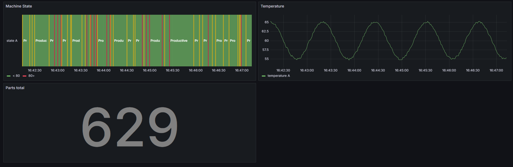
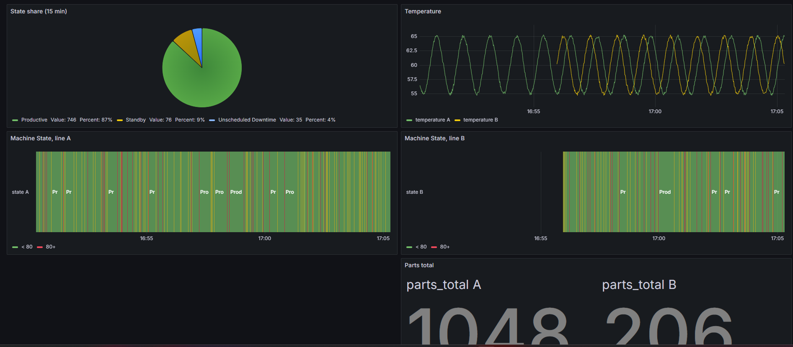
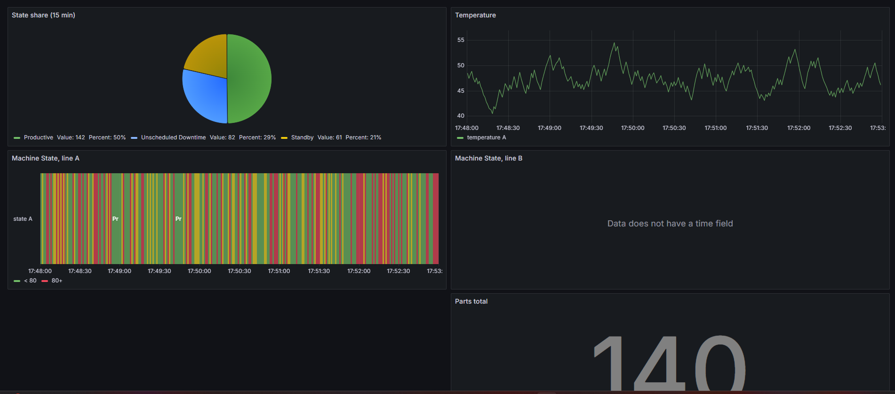

# Production Line: ball pen line, Grafana lab

Homework code for the Advanced Programming module (Production Line part), SRH Hochschule Berlin.
Student: Dany Degheady, ID 3120450.

The base is the lecture's ball pen simulation (`BallPenProductionLine`). Everything below is my own
extension of it, section by section, with the written answers in the accompanying homework document.

## Layout

| Folder | What is in it | How to run |
| --- | --- | --- |
| `backend/` | Ball pen back end with a spring component, an attempts guard (`LineStalled`), stations that return lists, 4 pytest tests, a deterministic batch age QC rule (`qc_batch_age.py`) | `python ballpen_production_line.py`, `python -m pytest` |
| `hmi/` | Matplotlib HMI with an alarm and bin bars, `SimulationState` with no drawing code, 4 tests | `python ballpen_animation_hmi.py`, `python -m pytest` |
| `grafana_lab/` | Docker Compose for InfluxDB 2.7 and Grafana 11, `producer.py`, `producer_B.py` (second line), `cmms_demo.py` (scheduled downtime) | `docker compose up -d`, then `python producer.py` |
| `docs/screenshots/` | Evidence from my own runs: HMI frames and the Grafana dashboards | |

## Setup

```
python -m pip install -r requirements.txt
```

`python -m pip` makes sure the packages go into the same Python that runs the scripts.

## Backend

```
cd backend
python -m pytest
python ballpen_production_line.py
```

## HMI

```
cd hmi
python -m pytest
python ballpen_animation_hmi.py
```

The renderer only calls `SimulationState.snapshot()`. All the state lives in `simulation_state.py`,
so it can be tested without matplotlib.

## Grafana lab

```
cd grafana_lab
docker compose up -d
python producer.py
```

Grafana runs on http://localhost:3000 (admin / admin). The username is `admin`, not an email address.
Data source: InfluxDB, query language Flux, URL `http://influxdb:8086`, organisation `lecture`,
token `my-super-secret-token`, bucket `factory`. These are the lecture's throwaway local credentials.

Settings at the top of `producer.py`:

- `LINE`: the `line` tag. `producer_B.py` is the same file with `LINE = "B"`.
- `WEIGHTS`: probability of Productive, Standby and Unscheduled Downtime per second.
- `COUPLE_TEMPERATURE`: `False` is the lecture behaviour (temperature ignores the state), `True` lets a
  stopped machine cool towards 35 degrees.
- `VIBRATION_BY_STATE`: the extra variable `vibration` (mm/s), high while Productive and near zero when stopped.
- `python producer.py --dry-run` prints values without writing to InfluxDB.

Results from my run (details in the homework document): longest Unscheduled Downtime 2 seconds,
84% Productive over 15 minutes with weights 0.85 / 0.10 / 0.05, availability 245 of 286 samples (85.7%).
With the lecture code the temperature and the parts counter do not react to the state, which is why
`COUPLE_TEMPERATURE` exists.

## Screenshots




